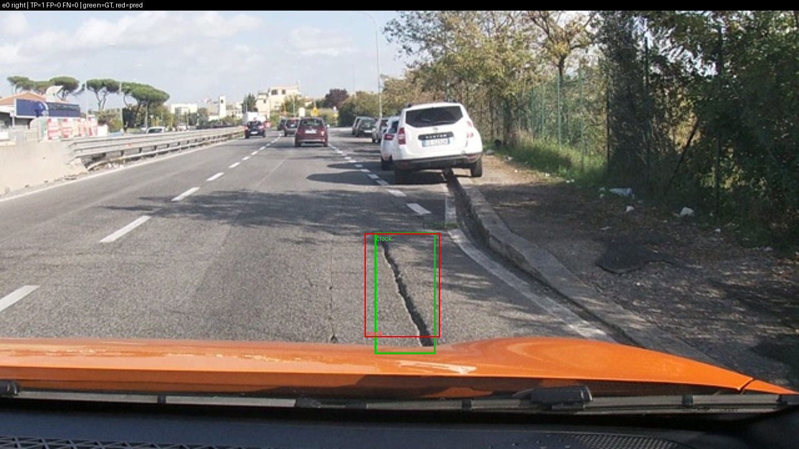
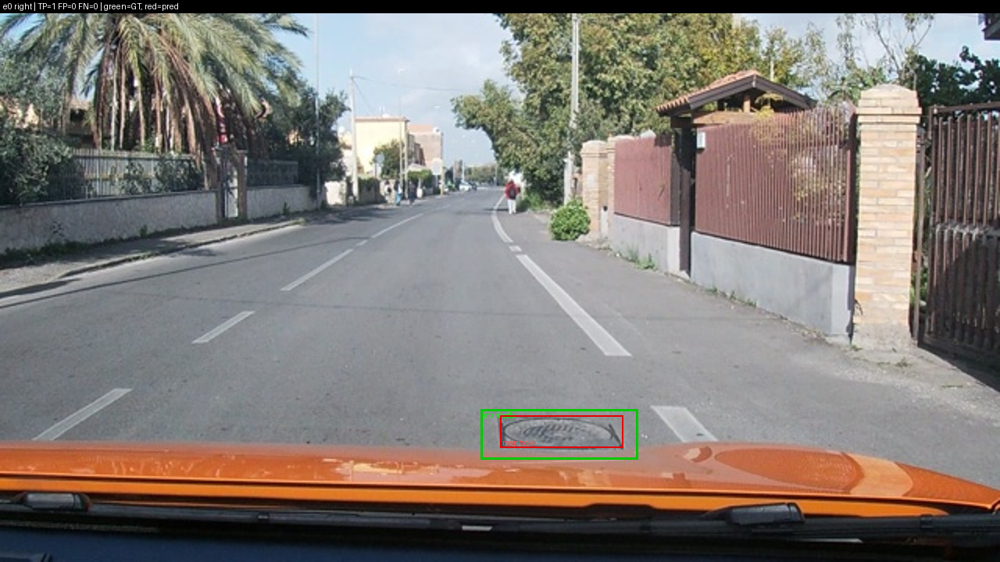
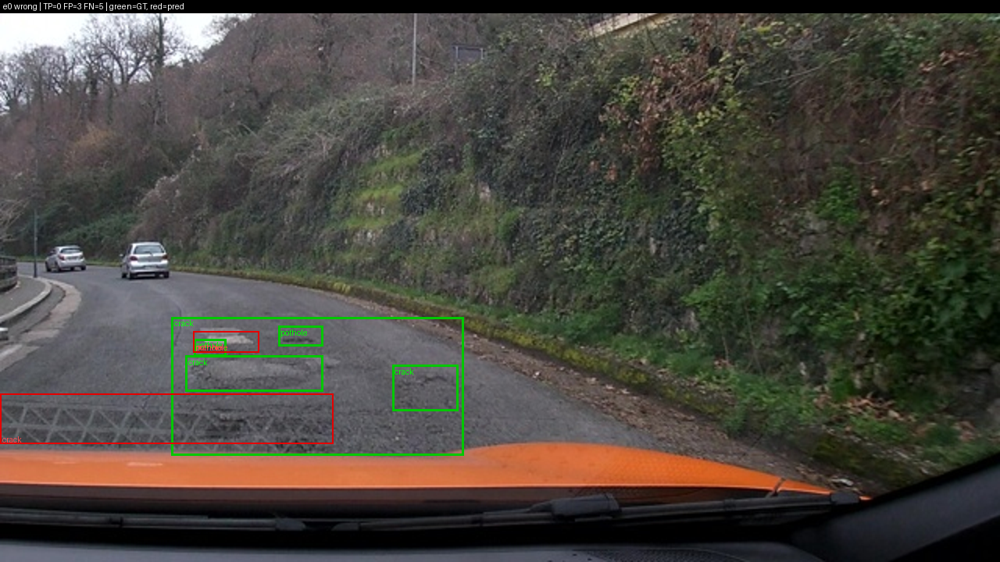
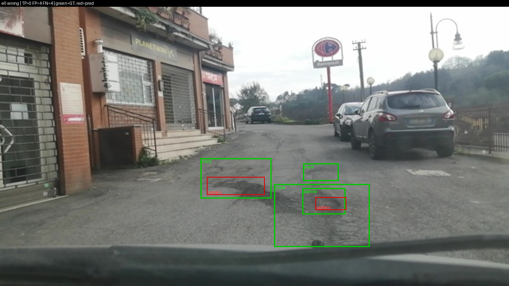
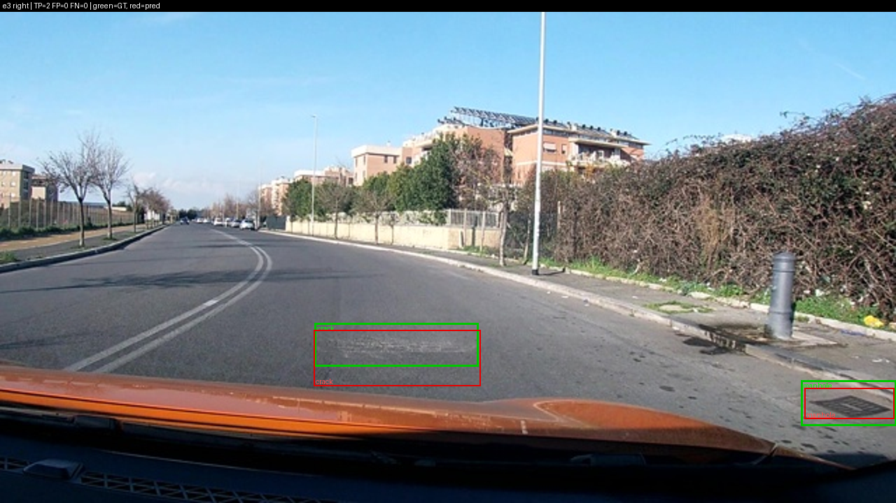
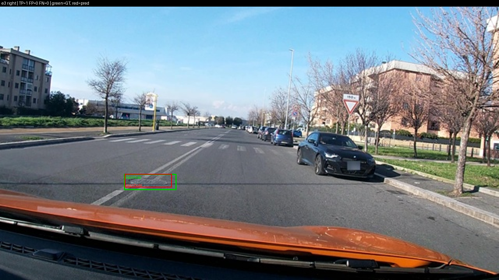
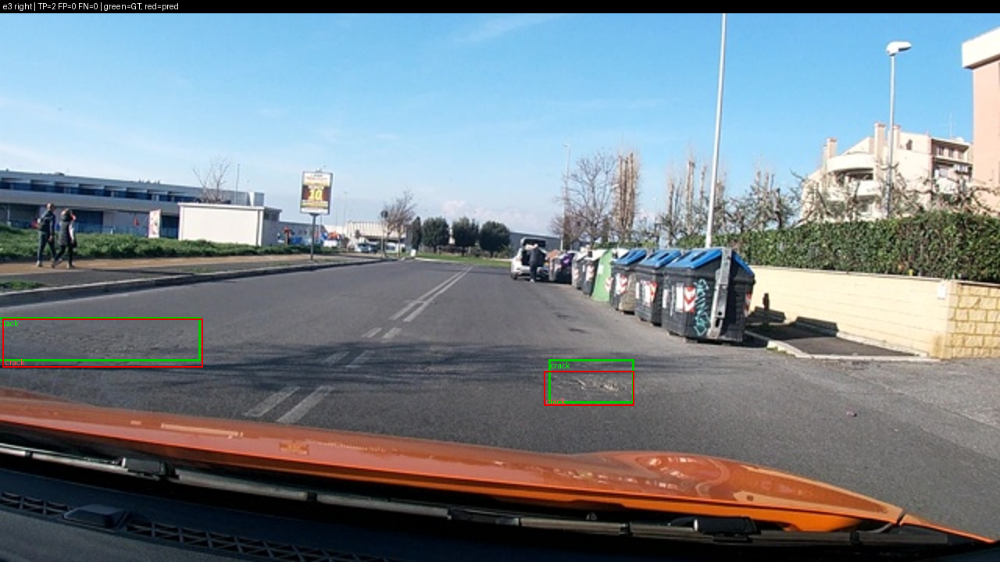
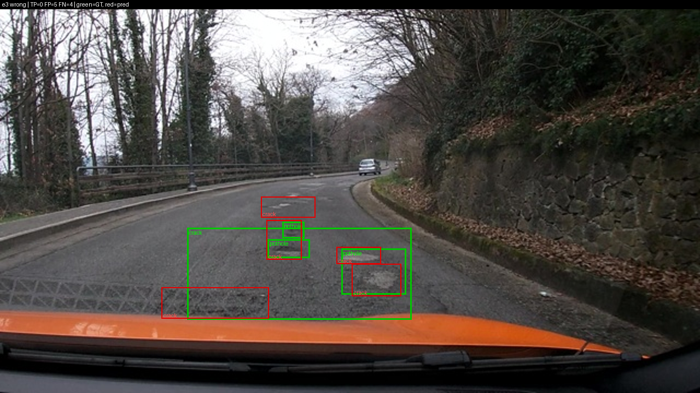
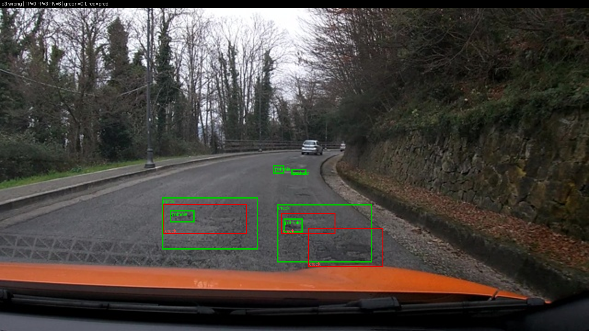
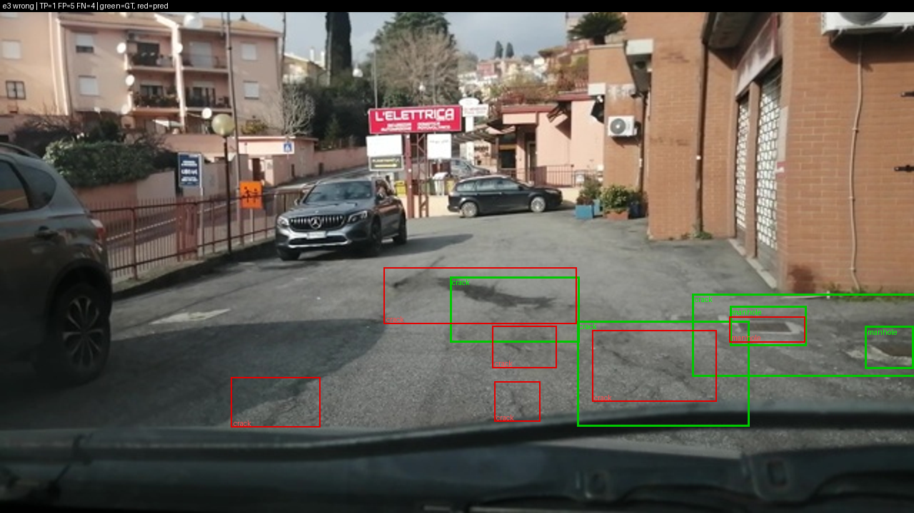

Họ tên: Nguyễn Cảnh Duy
`dataset_version`: d10-21e4070301

## Bảng tổng hợp (số của bạn, lấy từ `report/evidence/*.json`)

Test = 311 ảnh, 583 box (pothole 121, crack 299, manhole 163). E4 = ablation `data_size` trên setup E3 (chi tiết ở Câu 10).

| Mã | Setup       | Tham số huấn luyện | VRAM đỉnh (GB) | Phút |    F1 |         CI95 | FP/ảnh | F1 pothole | F1 crack | F1 manhole |
| --- | ----------- | --------------------: | ---------------: | ----: | ----: | -----------: | ------: | ---------: | -------: | ---------: |
| E0  | zero-shot   |                     0 |               – |    – | 0.079 | 0.055–0.108 |    0.85 |      0.159 |    0.024 |      0.142 |
| E1  | LoRA LLM    |            33,030,144 |             6.45 |  80.0 | 0.254 | 0.216–0.289 |    1.20 |      0.138 |    0.180 |      0.528 |
| E2  | + projector |           142,135,296 |             6.75 |  91.1 | 0.338 | 0.294–0.384 |    0.95 |      0.223 |    0.271 |      0.569 |
| E3  | + LoRA ViT  |           148,426,752 |             8.30 |  52.2 | 0.411 | 0.368–0.456 |    0.95 |      0.296 |    0.336 |      0.657 |
| E4  | E3, data 0.1 (142 ảnh) |  148,426,752 |             7.75 |  56.9 | 0.322 | 0.289–0.357 |    1.52 |      0.223 |    0.245 |      0.608 |
| E4  | E3, data 1.0 (= E3)    |  148,426,752 |             8.30 |  52.2 | 0.411 | 0.368–0.456 |    0.95 |      0.296 |    0.336 |      0.657 |

Thêm: `parse_valid_rate` E0 = 0.910, E1–E3 = 1.000, E4 data 0.1 = 0.997. Mean IoU của các box khớp: E0 0.616, E1 0.681, E2 0.672, E3 0.697. Precision / recall: E0 0.117 / 0.060, E1 0.271 / 0.238, E2 0.377 / 0.307, E3 0.435 / 0.389.

## 10 câu hỏi (trả lời bằng **số của bạn**, không chép lại tài liệu)

### Câu 1 — Kiến trúc: ViT, projector và LLM của Qwen3-VL-4B có bao nhiêu tham số mỗi khối, và E1/E2/E3 mỗi cái cập nhật khối nào?

Số đo từ `python -m labsrc.count_params` (khung model rỗng, tổng **4,437,815,808** tham số):

| Khối | Tham số |
|---|---:|
| LLM (`language_model`) | 4,022,468,096 |
| ViT + projector (`visual`) | 415,347,712 |
| ├ `visual.blocks` (ViT thuần) | 302,309,376 |
| ├ `visual.merger` | 27,271,680 |
| └ `visual.deepstack_merger_list` | 81,833,472 |

Projector = merger + deepstack = **109,105,152** tham số. Số module khớp regex LoRA: 252 (LLM) và 96 (ViT), đúng mong đợi. Từ `meta.trainable_params`:
- **E1**: 33,030,144 tham số, là LoRA r=16 trên 252 module của LLM. ViT và projector đóng băng.
- **E2**: 142,135,296 = 33,030,144 + 109,105,152, tức E1 cộng toàn bộ projector (huấn luyện đầy đủ, không LoRA).
- **E3**: 148,426,752 = 142,135,296 + 6,291,456, tức E2 cộng LoRA trên 96 module của ViT (348 module LoRA tổng).

Mọi setup chạy trên nền 4-bit NF4, trừ ViT và `lm_head`.

### Câu 2 — E0: `parse_valid_rate` bằng bao nhiêu, và hai lỗi phổ biến nhất của model gốc là gì (kèm một ví dụ output thô)?

`parse_valid_rate` của E0 = **0.910** (283/311 ảnh parse được; E1–E3 đều đạt 1.000). Phân loại 311 output thô của E0: **257** parse OK có box, **26** trả `[]` (không thấy gì), **28** không parse được. Hai lỗi phổ biến nhất:

1. **JSON hỏng (28 ảnh, 9%)**, gồm hai kiểu: (a) 21 ảnh bị **lặp vô hạn rồi cắt cụt** do chạm giới hạn 256 token: model xếp chồng hàng chục box `crack` kế nhau (y tăng dần) cho đến khi hết token, nên thiếu dấu đóng `]`; (b) 7 ảnh đóng ngoặc sai, kết thúc bằng `)}]` thay vì `]}]`.
2. **Box sai lớp và sai kích thước, nhất là crack**: E0 dự đoán 193 box crack nhưng chỉ 6 đúng (precision 0.031, recall 0.020, F1 0.024). Diện tích trung vị của box crack E0 đoán là 4.45% khung hình (E3 chỉ 1.78%, box thật trung vị ≈0.7% theo README), và 29/193 box crack phủ hơn 25% khung hình, ví dụ `[{"label": "crack", "bbox_2d": [0, 604, 1000, 750]}]` trên ảnh `vlcsnap-2025-02-18-18h30m20s293` (val). Thêm nữa 26 ảnh bị trả `[]`, nên tổng recall chỉ 0.060 (35 TP / 583 box).

Ví dụ output thô (ảnh `vlcsnap-2025-02-18-23h14m37s362`, test), bị cắt cụt:
`[{"label": "crack", "bbox_2d": [500, 309, 525, 324]}, {"label": "crack", "bbox_2d": [500, 324, 525, 338]}, {"label": "crack", "bbox_2d": [500, 338, 525, 352]}, ... {"label": "crack", "bbox_2d": [500, 408, ` (hết token ở đây).

Điều đáng chú ý: khi model khớp được box thì mean IoU vẫn 0.616, tức nó đã dùng đúng thang 0–1000 ngay từ zero-shot. Vấn đề của E0 là nhận diện lớp, kích thước và định dạng, không phải thang toạ độ.

Ảnh minh hoạ E0 (xanh lá = box thật, đỏ = box dự đoán; ảnh từ `labsrc.viz.make_figures`):

| Ảnh | Chú thích |
|---|---|
|  | **E0 đúng** (TP 1, FP 0, FN 0): ảnh chỉ có một vết nứt rõ, zero-shot khớp được. |
|  | **E0 đúng** (TP 1, FP 0, FN 0): một nắp cống, hình dạng đặc trưng nên zero-shot nhận ra. Các ảnh E0 đúng đều là ảnh chỉ có một đối tượng. |
|  | **E0 sai** (TP 0, FP 3, FN 5): box `crack` đỏ lớn nằm trên **vạch sơn zig-zag** ở đáy khung hình (vạch kẻ đường, không phải hư hại). Box `pothole` đặt gần đúng chỗ nhưng lệch nên IoU < 0.5. Vùng crack lớn và hai pothole còn lại bị bỏ sót. |
|  | **E0 sai** (TP 0, FP 4, FN 4): model tìm **đúng vùng** (box đỏ nằm bên trong box xanh) nhưng box chặt hơn nhiều so với quy ước gán nhãn của dataset, nên IoU < 0.5 và tính là cả FP lẫn FN. Đây là lỗi "đúng chỗ, sai kích thước" mà fine-tune sửa được. |

### Câu 3 — Thang 0–1000: nếu chấm output theo pixel (hoặc ngược lại) thì F1 ra sao và vì sao? Bạn đã kiểm chứng điều này thế nào?

Tôi chấm lại **cùng file dự đoán của E1** (`work/e1.jsonl`) nhưng khai báo `--coord pixel` (ghi ra `work/`, không vào `report/evidence/`). Kết quả: **F1 = 0.000** (P = 0, R = 0, mean IoU = 0, CI95 0.000–0.000), FP/ảnh = 1.65 (513 box dự đoán, không box nào khớp), trong khi `parse_valid_rate` vẫn = 1.000. So với F1 = 0.254 khi chấm đúng `norm1000`, F1 mất hoàn toàn.

Vì sao: model xuất toạ độ nguyên trên thang 0–1000 so với kích thước ảnh. Nếu chấm như pixel, bộ chấm lại chia cho 640 (rộng) và 360 (cao) để quy về 0–1000, nên mỗi box bị phóng x khoảng 1.56 lần và y khoảng 2.78 lần: box lệch xa và nhiều box vượt ra ngoài khung. Hầu như không còn IoU ≥ 0.5 nào, nên TP = 0. JSON vẫn hợp lệ nên `parse_valid_rate` không đổi, vì thế phải nhìn F1 và IoU chứ không chỉ tỉ lệ parse. Kiểm chứng ngược chiều: chấm đúng thang cho mean IoU 0.62–0.70 ở E0–E3.

### Câu 4 — Mask loss: vì sao chỉ tính loss trên phần trả lời? Điều gì xảy ra nếu tính trên cả prompt và token ảnh?

Prompt và token ảnh (220 token vision cho mỗi ảnh 640×360) là *điều kiện đầu vào*, không phải thứ model cần sinh ra; chỉ phần JSON đáp án (cộng `<|im_end|>`) mới là mục tiêu. `encode_example` che mọi thứ trước đáp án bằng nhãn −100. Nếu tính loss cả prompt và ảnh: (1) phần lớn gradient dồn vào việc dự đoán lại prompt cố định và token ảnh, nên loss trông thấp giả tạo mà không cải thiện đầu ra; (2) tín hiệu cho phần toạ độ bị pha loãng; (3) model bị kéo sang việc "chép" prompt. Với mask đúng, loss huấn luyện đi từ 2.09 (bước 1) xuống 0.55 (E1), 0.51 (E2), 0.45 (E3) sau 300 bước, và `parse_valid_rate` từ 0.910 (E0) lên 1.000 (E1–E3), tức model học đúng định dạng JSON và dừng đúng chỗ (E0 có 21 ảnh bị cắt cụt, E1–E3 không có ảnh nào hỏng). Tôi **không** chạy ablation bỏ mask nên không có số F1 so sánh trực tiếp cho trường hợp này.

### Câu 5 — Vì sao không thể huấn luyện đầy đủ projector nếu ViT bị lượng tử hoá 4-bit, và bạn đã xử lý thế nào? Vì sao projector phải ở float32?

Khi ViT bị lượng tử 4-bit, trọng số của merger là trọng số nén (`Params4bit`), optimizer không cập nhật đầy đủ được. Cách xử lý: đặt `llm_int8_skip_modules=["visual", "lm_head"]` để ViT (kèm projector) và `lm_head` giữ fp16 (có `assert_vit_not_quantized` trong `load_model`), rồi trong `apply_setup` mở `visual.merger` + `visual.deepstack_merger_list` và **ép float32**. Float32 là bắt buộc vì `GradScaler.unscale_` từ chối gradient fp16 (lỗi "Attempting to unscale FP16 gradients"), nên mọi tham số huấn luyện phải ở fp32. Tôi kiểm chứng bằng `labsrc.debug_dtype` trên E3: các nhóm tham số đang huấn luyện đều là float32 (`lora_vit` 6,291,456 / 192 tensor; `visual.merger` 27,271,680 / 6 tensor; `visual.deepstack_merger_list` 81,833,472 / 18 tensor; `lora_llm` 33,030,144 / 504 tensor), **0** tham số có grad không phải fp32 và không còn projector nào bị đóng băng. Chi phí đo được: E2 huấn luyện thêm 109,105,152 tham số projector so với E1, VRAM đỉnh tăng từ 6.45 lên 6.75 GB (+0.30 GB).

### Câu 6 — Split theo phiên quay: vì sao chia ngẫu nhiên sẽ cho F1 cao giả? Số ảnh và số box từng lớp ở mỗi split là bao nhiêu?

Dữ liệu là frame cắt từ video dashcam, nên hai frame liền kề gần như trùng nhau. Chia ngẫu nhiên sẽ đặt các frame gần giống nhau ở cả train và test (rò rỉ), model "đã thấy" ảnh test lúc train và F1 cao giả. `prepare_data.py` gom ảnh theo phiên quay (ngày + giờ trong tên file) và gán cả phiên vào một split: train có 13 phiên, val 2, test 3 (output của notebook, `dataset_version` d10-21e4070301).

| Split |  Ảnh | pothole | crack | manhole |
| ----- | ----: | ------: | ----: | ------: |
| train | 1,422 |   1,074 | 1,750 |     691 |
| val   |   276 |      66 |   470 |     103 |
| test  |   311 |     121 |   299 |     163 |

Số box test khớp với bằng chứng chấm (TP+FN: pothole 121, crack 299, manhole 163). Phân bố lớp không đều giữa các split (val chỉ có 66 pothole), nên phải đọc F1 từng lớp chứ không chỉ F1 gộp. Chỉ 3 phiên trong test cũng cho thấy các box trong cùng một phiên tương quan mạnh, nên CI95 thực tế có thể rộng hơn con số báo cáo.

### Câu 7 — So sánh E1/E2/E3: mở projector và LoRA trên ViT có đáng không (F1, CI95, VRAM, thời gian)?

|    |    F1 | CI95         | VRAM (GB) | Phút |
| -- | ----: | ------------ | --------: | ----: |
| E1 | 0.254 | 0.216–0.289 |      6.45 |  80.0 |
| E2 | 0.338 | 0.294–0.384 |      6.75 |  91.1 |
| E3 | 0.411 | 0.368–0.456 |      8.30 |  52.2 |

- **E1 → E2 (mở projector)**: +0.085 F1, chỉ tốn +0.30 GB VRAM. CI95 gần như không chồng nhau (cận trên E1 0.289 so với cận dưới E2 0.294), nên mức tăng khá đáng tin. Rất đáng.
- **E2 → E3 (LoRA ViT)**: +0.072 F1, tốn +1.55 GB VRAM. CI95 **chồng nhau** (0.368–0.384), nên chưa kết luận chắc E3 hơn E2 chỉ từ khoảng tin cậy trên 311 ảnh.
- **E1 → E3**: +0.157 F1, CI95 tách hẳn nhau, nên E3 chắc chắn tốt hơn E1.
- Thời gian: E1 80.0, E2 91.1, E3 52.2 phút. Con số này **không** phản ánh chi phí tính toán thực: log E1 cho thấy 100 bước đầu mất 22.1 phút rồi chậm lại còn khoảng 29 phút mỗi 100 bước (GPU Colab bị chậm giữa chừng), E2 chạy với batch 1 × accum 8 (E1 và E3 dùng batch 2 × accum 4), và E3 chạy trong phiên khác. Vì vậy tôi chỉ so sánh VRAM, tham số và F1, không kết luận về thời gian.
  Kết luận: E3 cho F1 cao nhất và VRAM 8.3 GB vẫn vừa T4; E2 là điểm cân bằng nếu cần tiết kiệm.

### Câu 8 — Tập test có 311 ảnh: khoảng tin cậy rộng thế nào, và điều đó giới hạn kết luận so sánh các setup ra sao?

Độ rộng CI95 của F1: E0 0.053, E1 0.073, E2 0.090, E3 0.088 (nửa độ rộng khoảng ±0.03 đến ±0.045). Kết luận còn đứng vững: E1 hơn E0 (0.254 so với 0.079, chênh 0.175, CI không chạm nhau), và E3 hơn E1 (chênh 0.157, CI tách nhau). E4 (data 1.0 so với 0.1, chênh 0.089) cũng có CI tách nhau, nhưng khoảng hở chỉ 0.011 (0.357 so với 0.368), nên kết luận đứng được ở mức biên. Kết luận không đứng vững: E2 so với E3 (chênh 0.072 nhưng CI chồng nhau 0.368–0.384), và E1 so với E2 chỉ ở mức biên (khoảng cách giữa hai CI chỉ 0.005). Lý do khoảng rộng: chỉ 311 ảnh/583 box, và các box tương quan theo phiên quay nên số mẫu độc lập thực tế còn ít hơn. Vì thế chênh lệch dưới khoảng 0.07–0.09 giữa hai setup không nên được coi là khác biệt thật.

### Câu 9 — Phân tích lỗi theo lớp: lớp nào kém nhất và vì sao (kích thước box, số mẫu, ngữ nghĩa)? Kèm ảnh minh hoạ.

Sau khi fine-tune, lớp kém nhất là **pothole** ở cả E1/E2/E3 (F1 0.138 / 0.223 / 0.296), tiếp theo là crack (0.180 / 0.271 / 0.336), còn manhole tốt nhất (0.528 / 0.569 / 0.657). Với E3, pothole chỉ bắt được 30/121 box (recall 0.248, FP 52); model chỉ dự đoán 82 box pothole so với 121 box thật, tức bỏ sót nhiều. Crack thì ngược lại: E3 dự đoán 320 box cho 299 box thật nhưng chỉ 104 đúng (precision 0.325, FP 216), tức đoán đủ số lượng nhưng sai vị trí hoặc IoU không đạt 0.5. Manhole đoán 120 box cho 163 box thật với precision cao nhất (0.775).

Số mẫu **không** giải thích được thứ hạng: train có 1,074 pothole, nhiều hơn manhole (691), nhưng manhole vẫn tốt hơn nhiều. Kích thước box cũng **không** giải thích hết. Diện tích trung vị của box **thật** (tính từ nhãn YOLO, `w·h`) là:

| Lớp | Train | Test | E3 dự đoán (test) |
|---|---:|---:|---:|
| pothole | 0.38% | 0.42% | 0.41% |
| crack | 1.35% | 1.98% | 1.78% |
| manhole | 0.39% | 0.67% | 0.62% |

Trong train, pothole và manhole nhỏ gần bằng nhau (0.38% so với 0.39% khung hình), vậy mà manhole đạt F1 0.657 còn pothole chỉ 0.296. Box pothole E3 đoán cũng đúng cỡ (0.41% so với 0.42% thật), nên vấn đề của pothole là **không phát hiện ra hoặc gán sai lớp** (recall 0.248), không phải đoán sai kích thước. Theo tôi, nguyên nhân nằm ở ngữ nghĩa và hình dạng. Nắp cống là vật tròn hoặc vuông bằng kim loại, có cạnh rõ và trông giống nhau giữa các ảnh. Ổ gà có hình dạng bất định, dễ lẫn với mảng nhựa vá, bóng râm và vết nứt. Trong dataset, box pothole còn thường nằm **lồng bên trong** box crack lớn (xem ảnh dưới), nên ranh giới giữa hai lớp vốn đã mơ hồ. Crack là lớp có box lớn nhất nhưng dài, mảnh và không rõ phạm vi: người gán nhãn hay khoanh cả một vùng lớn, còn model chia vùng đó thành nhiều box nhỏ, nên IoU < 0.5 dù đúng chỗ. Ngoài ra box crack ở test lớn hơn ở train (1.98% so với 1.35%), tức có lệch phân bố giữa các phiên quay.

Ảnh minh hoạ E3 (xanh lá = box thật, đỏ = box dự đoán). Ảnh "đúng" là ảnh có FP = FN = 0; ảnh "sai" là 3 ảnh có FP + FN lớn nhất:

| Ảnh | Chú thích |
|---|---|
|  | **E3 đúng** (TP 2): vệt nứt ngang làn và nắp cống sát mép phải đều khớp. Box crack dự đoán lệch xuống dưới so với box thật nhưng vẫn đạt IoU ≥ 0.5. |
|  | **E3 đúng** (TP 1): một nắp cống, khớp đúng nhãn và vị trí. |
|  | **E3 đúng** (TP 2): hai vết nứt (một ở mép trái, một giữa làn phải) đều khớp gần trùng box thật. Cả ba ảnh đúng đều chỉ có 1–2 đối tượng và thuộc cùng một chuỗi frame (`vlcsnap-002xx`); ảnh 00200 và 00205 chụp trời nắng, mặt đường phẳng. Ngược lại, các ảnh sai đều có 4–6 box thật trên mặt đường xuống cấp nặng. |
|  | **E3 sai** (TP 0, FP 5, FN 4): box thật gồm 1 crack rất lớn phủ gần hết làn và 3 pothole nhỏ. E3 đoán 5 box `crack`, trong đó hai box nằm **đúng chỗ pothole nhưng gán nhãn crack** (nhầm pothole → crack), còn vùng crack lớn bị chia thành nhiều box nhỏ nên không box nào đạt IoU 0.5. |
|  | **E3 sai** (TP 0, FP 3, FN 6): box thật gồm 2 crack lớn **chứa pothole lồng bên trong**, cùng 2 pothole rất nhỏ ở xa. E3 chỉ đoán 3 box crack nhỏ hơn hoặc lệch so với box thật (IoU < 0.5) và bỏ sót cả 4 pothole. Ảnh này cách ảnh trên 3 giây trong cùng một phiên quay, nên hai lỗi này tương quan với nhau (liên quan đến Câu 8). |
|  | **E3 sai** (TP 1, FP 5, FN 4): nắp cống ở giữa khớp (TP), nắp cống bị cắt ở mép phải thì bỏ sót. 5 box `crack` dự đoán rơi vào các mảng nhựa vá, vết bẩn sẫm màu và bóng râm, trong khi box crack thật bao cả vùng lớn, nên lệch phạm vi. |

### Câu 10 — E4: bạn đổi biến nào, kết quả thế nào, và kết luận có đáng tin không?

**Biến đổi: `data_size`** (`--train-fraction`), hai giá trị 0.1 và 1.0, đặt trên setup **E3**. Tôi chọn E3 làm gốc vì nó có F1 cao nhất trong E1–E3. Cần nói rõ: chọn theo F1 trên **test** là hơi "nhìn trộm" tập test; đúng ra nên chọn trên val. Mọi thứ khác giữ nguyên như E3: `configs/e3.yaml` (LoRA r=16 trên LLM + ViT, projector huấn luyện đầy đủ ở fp32), 300 bước, lr 2e-4, seed 42, và **batch 2 × accum 4** (`run.json` của cả hai đều ghi 2×4). Giá trị 1.0 chính là run E3 nên tôi dùng lại dự đoán `work/e3.jsonl` và `meta` của nó. Giá trị 0.1 là 142 ảnh lấy ngẫu nhiên (seed 42) từ 1,422 ảnh train. Bằng chứng: `report/evidence/e4_data_size_0.1.json` và `e4_data_size_1.0.json`.

| data_size | Ảnh train | F1 | CI95 | P | R | FP/ảnh | F1 pothole | F1 crack | F1 manhole | VRAM (GB) | Phút | Loss TB 10 bước cuối |
|---|---:|---:|---|---:|---:|---:|---:|---:|---:|---:|---:|---:|
| 0.1 | 142 | 0.322 | 0.289–0.357 | 0.300 | 0.348 | 1.52 | 0.223 | 0.245 | 0.608 | 7.75 | 56.9 | 0.009 |
| 1.0 | 1,422 | 0.411 | 0.368–0.456 | 0.435 | 0.389 | 0.95 | 0.296 | 0.336 | 0.657 | 8.30 | 52.2 | 0.507 |

**Kết quả:** chỉ dùng 10% dữ liệu làm F1 giảm **0.089** (0.411 → 0.322). Cả ba lớp đều giảm: pothole −0.073, crack −0.091, manhole −0.049.

**Vì sao:** cả hai bản đều chạy 300 bước × 8 ảnh = 2,400 lượt ảnh. Với 142 ảnh, mỗi ảnh được xem khoảng **17 lần** (≈ 17 epoch); với 1,422 ảnh chỉ khoảng 1.7 epoch. Loss huấn luyện của bản 0.1 rơi xuống **0.009**, tức model gần như thuộc lòng đáp án của 142 ảnh (bản 1.0 dừng ở 0.507). Đây là overfitting. Hậu quả chủ yếu nằm ở **precision** (0.435 → 0.300), còn recall chỉ giảm nhẹ (0.389 → 0.348). Bản 0.1 đoán **677 box** (2.18 box/ảnh), nhiều hơn số box thật (583) và nhiều hơn E3 (522 box). FP tăng từ 295 lên 474, chủ yếu ở crack (216 → 330) và pothole (52 → 110). Manhole ít bị ảnh hưởng nhất: cả hai bản đều đoán ra 120 box manhole (đúng 86 so với 93), và F1 chỉ giảm 0.049. Điều này khớp với Câu 9: manhole là lớp có hình dạng dễ nhận nhất. `parse_valid_rate` vẫn 0.997 (1/311 ảnh hỏng), nên học định dạng JSON chỉ cần ít dữ liệu; cái cần nhiều dữ liệu là **phân biệt đúng vùng hư hại**. VRAM đỉnh thấp hơn ở bản 0.1 (7.75 so với 8.30 GB). Nhiều khả năng là do VRAM đỉnh phụ thuộc chuỗi dài nhất từng gặp (ảnh nhiều box), và tập 142 ảnh ít ảnh như vậy hơn; tôi chưa kiểm chứng điều này. Thời gian gần như nhau (56.9 so với 52.2 phút) vì cùng 300 bước; phần chênh là do GPU Colab, không phải do dữ liệu.

**Có đáng tin không:** CI95 **không chồng nhau**, nhưng khoảng hở chỉ **0.011** (cận trên 0.357 so với cận dưới 0.368). Vì vậy kết luận "nhiều dữ liệu hơn tốt hơn" đứng được, nhưng ở mức biên, còn độ lớn chính xác của mức chênh (0.089) thì chưa chắc. Có bốn giới hạn:
1. Chỉ một seed và một tập con 142 ảnh, nên tôi chưa đo được F1 dao động bao nhiêu giữa các tập con khác nhau.
2. CI95 tính theo ảnh, nhưng test chỉ có 3 phiên quay, nên khoảng thật có thể rộng hơn, đủ để khoảng hở 0.011 biến mất (Câu 8).
3. Hai bản chạy ở hai phiên Colab khác nhau (bản 1.0 là run E3 cũ), dù cùng config và cùng batch.
4. So sánh hai CI riêng rẽ là cách thận trọng. Bootstrap theo cặp trên hiệu F1 (cùng tập ảnh test) sẽ phù hợp hơn, nhưng tôi chưa làm.

Quan sát thêm: chỉ với 142 ảnh, setup E3 đã đạt F1 0.322, ngang E2 dùng toàn bộ dữ liệu (0.338, CI chồng nhau) và hơn E1 (0.254; hai CI chạm nhau ở 0.289). Tuy nhiên so sánh này khác nhau ở **hai** biến cùng lúc (lượng dữ liệu và khối được mở), nên chỉ để tham khảo, không phải kết luận của ablation.

## Nhìn lại

E0–E4 đã chạy và chấm trên toàn bộ 311 ảnh test, cùng `dataset_version` d10-21e4070301; `check_submission.py` báo 0 FAIL. Fine-tuning giúp rõ rệt: F1 tăng từ 0.079 (zero-shot) lên 0.254 (E1), 0.338 (E2) và 0.411 (E3); `parse_valid_rate` tăng từ 0.910 lên 1.000. Mở projector là bước hiệu quả nhất so với chi phí (+0.085 F1, chỉ tốn thêm 0.30 GB VRAM). LoRA trên ViT cho F1 cao nhất nhưng theo CI95 thì chưa tách khỏi E2. Ablation E4 cho thấy giảm dữ liệu xuống 10% làm F1 giảm 0.089, chủ yếu do overfitting làm tăng box bịa (FP/ảnh từ 0.95 lên 1.52).

Điều tôi chưa hiểu, hoặc công cụ chấm chưa bắt được:
1. E1 có nhiều FP hơn E0 (1.20 so với 0.85 FP/ảnh) dù F1 cao hơn nhiều. Tôi chưa kiểm tra xem có phải do model sau fine-tune luôn đoán ra box hay không (E1–E3 không còn ảnh nào trả `[]`, trong khi E0 trả `[]` ở 26 ảnh).
2. Test chỉ có 3 phiên quay nên các ảnh trong cùng phiên tương quan với nhau, và CI95 tính theo ảnh có thể quá lạc quan. Ví dụ, hai trong ba ảnh sai nhất của E3 cách nhau chỉ 3 giây.
3. `parse_valid_rate` không bắt được lỗi sai thang toạ độ (Câu 3: JSON vẫn hợp lệ nhưng F1 = 0).
4. Ngưỡng IoU 0.5 phạt nặng các trường hợp "đúng chỗ, khác phạm vi": vùng crack lớn bị model chia nhỏ, hoặc box chặt hơn quy ước gán nhãn (ảnh E0 sai thứ hai, ảnh E3 sai thứ nhất). Ngoài ra nhãn pothole lồng trong crack làm ranh giới giữa hai lớp mơ hồ ngay từ dữ liệu.

Giới hạn còn lại: thời gian huấn luyện giữa các setup không so sánh được; E4 chỉ có một seed; và GRPO (E5) chưa chạy.

## Bonus E5 (một phần)

Tôi mới làm phần **hàm reward và test**, chưa chạy GRPO. Hàm `labsrc/reward.py` tính `0.2 · (JSON hợp lệ) + 0.8 · (tổng IoU các cặp khớp cùng lớp với IoU ≥ 0.5) / max(n_gt, n_pred, 1)`. JSON hỏng được 0 điểm. Mẫu số `max(n_gt, n_pred)` phạt việc bịa thêm box, nên model không thể hack reward bằng cách đoán thật nhiều box. Ngược lại, trả `[]` khi ảnh có hư hại chỉ được 0.2, nên model cũng không thể hack bằng cách không đoán gì. `my_tests/test_reward.py` có 7 test (khớp hoàn hảo, JSON hỏng, sai lớp, box thừa bị phạt, rỗng với rỗng, `[]` khi có box thật, IoU thấp không được khớp). `python -m pytest -q my_tests` cho kết quả **7 passed** trên Colab. Vì chưa chạy GRPO nên tôi không có log huấn luyện hay số F1 nào để so với SFT.
